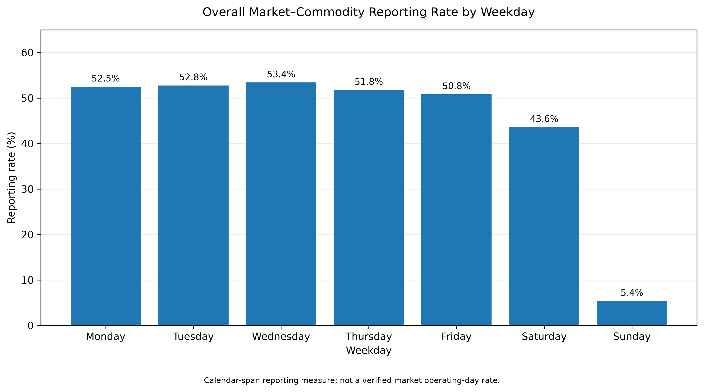
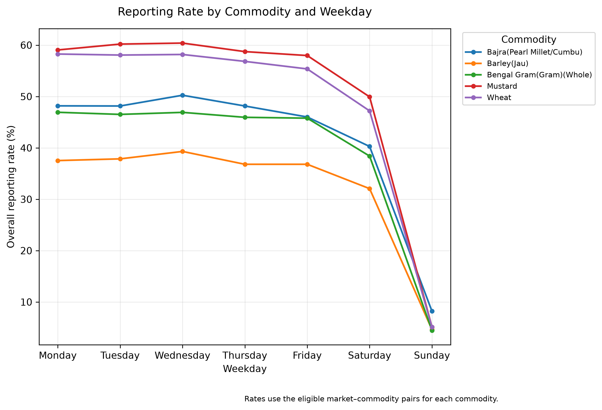
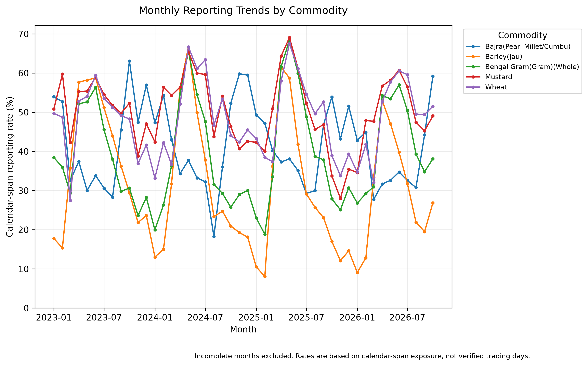
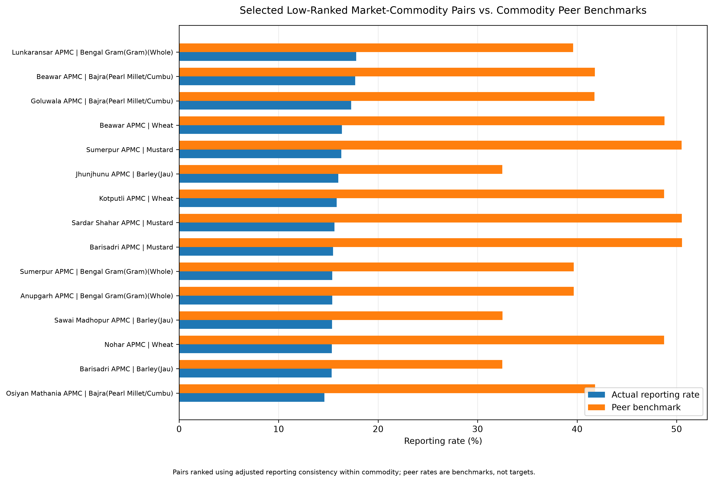
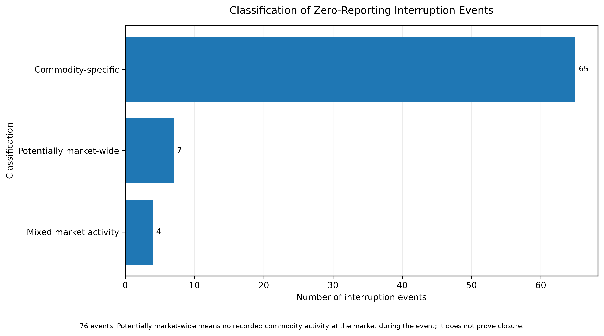
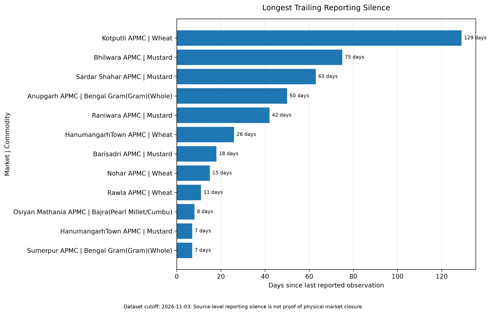

# Rajasthan Agricultural Market Price & Arrivals Intelligence

A reproducible data engineering and analytical intelligence project using official AGMARKNET agricultural market data from Rajasthan, India.

The project investigates agricultural market arrivals, modal prices, weekday and monthly reporting patterns, market–commodity reporting consistency, prolonged reporting interruptions, and trailing source-level reporting silence.

## Project Overview

This project transforms downloaded AGMARKNET CSV exports into a structured analytical dataset and investigates reporting behaviour across Rajasthan's agricultural markets.

The focus extends beyond price trends. It combines dimensional modelling, data quality validation, peer benchmarking, interruption classification, raw-source reconciliation, automated pipeline execution and analytical visualisation.

The objective is to distinguish genuine patterns in the downloaded records from conclusions that would require additional operational evidence.

## Project Objectives

- Build a structured dataset from multiple AGMARKNET CSV exports.
- Clean and validate market, commodity, date, arrival and modal-price fields.
- Develop a dimensional star schema for analytical use.
- Measure weekday and monthly reporting patterns.
- Identify market–commodity pairs with unusually low reporting activity.
- Compare reporting behaviour against commodity-specific peer benchmarks.
- Detect consecutive reporting interruptions and trailing reporting silence.
- Reconcile selected findings against original downloaded source exports.
- Automate the analytical pipeline and validate outputs through regression tests.
- Produce stakeholder-oriented analytical reports and charts.

## Dataset Overview

| Metric | Value |
|---|---:|
| Fact observations | 439,399 |
| Markets | 186 |
| Commodities | 18 |
| Commodity groups | 6 |
| Source CSV exports | 12 |
| Observation period | 1 Jan 2023 – 3 Nov 2026 |
| Calendar dimension | 1,461 dates |
| Eligible market–commodity pairs | 395 |
| Monthly pair-month panel | 17,093 rows |
| Selected focus commodities | 5 |

The five selected commodities are:

- Bajra (Pearl Millet)
- Mustard
- Bengal Gram (Whole)
- Wheat
- Barley (Jau)

The dataset includes arrival quantities measured in Metric Tonnes (MT) and modal prices measured in Indian Rupees per Quintal (₹/Quintal).

The reporting-silence investigation uses 3 November 2026 as its dataset cutoff.

## Technology Stack

- Python 3.12
- Pandas
- NumPy
- Matplotlib
- Pytest
- CSV-based analytical storage
- Git and GitHub
- PowerShell-based project execution

## Data Engineering Pipeline

The project follows these main stages:

1. **Source ingestion:** Read downloaded AGMARKNET CSV exports and handle report metadata rows.
2. **Data preparation:** Standardise fields, parse dates and prepare market and commodity identifiers.
3. **Dimensional modelling:** Build date, market and commodity dimensions alongside the market-arrivals fact table.
4. **Validation:** Check key integrity, fact-table grain, rejected dates and numerical ranges.
5. **Analytical transformations:** Generate temporal, weekday, monthly and market-level reporting datasets.
6. **Peer benchmarking:** Compare market–commodity reporting behaviour against commodity-specific peers.
7. **Interruption analysis:** Identify zero-reporting periods and classify source-level activity.
8. **Source reconciliation:** Compare selected processed-data findings against original raw exports.
9. **Trailing-silence investigation:** Audit extended periods without recorded observations.
10. **Regression testing:** Run automated checks after pipeline execution.

### Star Schema

The dimensional model consists of:

- `dim_date`
- `dim_market`
- `dim_commodity`
- `fact_market_arrivals`

The fact table uses date, market and commodity identifiers to connect observations to their dimensions.

## Analytical Investigations

### 1. Temporal Reporting Gaps

Examines reporting coverage and consecutive missing calendar-day intervals for market–commodity pairs.

### 2. Weekday Reporting Patterns

Compares reporting rates across the seven weekdays, including commodity-level differences.

### 3. Monthly Reporting Patterns

Builds a pair-month panel and compares observed reporting days with calendar-day exposure within each pair's observation period.

### 4. Peer-Adjusted Market Reporting Consistency

Compares each market–commodity pair against a leave-one-pair-out benchmark for the same commodity, with adjustment for weekday composition.

### 5. Zero-Reporting Interruption Analysis

Identifies consecutive months with no reports and examines whether other commodity observations were present in the same market during those periods.

### 6. Source-Level Reconciliation

Checks selected market–commodity interruption periods against original raw AGMARKNET exports to distinguish source-level absence from potential processing loss.

### 7. Trailing Reporting Silence

Examines the period between the last observed report and the dataset cutoff, distinguishing complete silent months from partial months.

## Selected Findings

### Weekday Reporting

- Wednesday had the highest overall calendar-span reporting rate at approximately 53.41%.
- Tuesday followed at approximately 52.77%.
- Saturday reporting was approximately 43.62%.
- Sunday reporting was approximately 5.40%.

### Market–Commodity Consistency

- 395 eligible market–commodity pairs were assessed.
- Fifteen selected low-ranked pairs were investigated further.
- Rankings were calculated within each commodity rather than globally across all pairs.

### Reporting Interruptions

A total of 76 interruption events were classified:

| Classification | Events |
|---|---:|
| Commodity-specific | 65 |
| Potentially market-wide | 7 |
| Mixed | 4 |
| **Total** | **76** |

### Trailing Reporting Silence

- Kotputli–Wheat was the longest selected trailing-silence case.
- Its last recorded observation was 27 June 2026.
- The elapsed period to the 3 November 2026 dataset cutoff was 129 days.
- Its five audited trailing-silence pair-months were classified as potentially market-wide at the source-record level.

These are descriptive findings from downloaded records, not proof of physical market closure, non-operation or an AGMARKNET system outage.

## Analytical Visualisations

Six analytical charts are generated using the project's chart-generation script.

### 1. Overall Weekday Reporting Rates



### 2. Commodity Weekday Reporting



### 3. Monthly Commodity Reporting Trends



### 4. Selected Market–Commodity Pairs vs Peer Benchmarks



### 5. Interruption Event Classification



### 6. Trailing Reporting Silence



## Reports and Documentation

Detailed analytical findings and supporting audits are available in the `reports/` directory.

- [Executive Summary](reports/executive_summary.md)
- [Detailed Analytical Report](reports/rajasthan_mandi_intelligence_report.md)
- [Source-Level Reporting Interruption Audit](reports/source_level_reporting_interruption_audit.md)
- [Trailing Reporting Silence Audit](reports/trailing_reporting_silence_audit.md)

## Repository Structure

```text
rajasthan-mandi-intelligence/
│
├── data/
│   ├── raw/                 # Local source exports; excluded from Git
│   └── processed/           # Processed datasets and analytical outputs
│
├── reports/
│   ├── figures/             # Generated analytical charts
│   ├── executive_summary.md
│   ├── rajasthan_mandi_intelligence_report.md
│   ├── source_level_reporting_interruption_audit.md
│   └── trailing_reporting_silence_audit.md
│
├── scripts/                 # Pipeline and analytical scripts
├── tests/                   # Automated regression tests
├── logs/                    # Pipeline execution logs; excluded from Git
├── requirements.txt
├── requirements-dev.txt
├── .gitignore
└── README.md
```

## Setup

Python 3.12 or a compatible Python 3 version is recommended.

### Create and activate a virtual environment

```powershell
python -m venv .venv
.\.venv\Scripts\Activate.ps1
```

### Install development dependencies

```powershell
python -m pip install -r requirements-dev.txt
```

## Running the Project

### Run the complete analytical pipeline

```powershell
python .\scripts\run_pipeline.py
```

The pipeline orchestrates 21 analytical and audit stages, performs preflight checks, creates timestamped backups, writes execution logs and runs the regression test suite as a final validation gate.

### Run regression tests independently

```powershell
python -m pytest .\tests -v
```

The current regression suite contains 27 tests.

### Generate analytical charts

```powershell
python .\scripts\generate_analytical_charts.py
```

Chart generation is currently a separate step from the main pipeline.

## Data Availability

Raw AGMARKNET exports are not included in the Git repository.

To reproduce the pipeline from source, obtain the corresponding AGMARKNET exports and place them in:

```text
data/raw/
```

Processed datasets and analytical outputs are available under:

```text
data/processed/
```

The complete pipeline requires the source exports to be present locally.

## Data Quality and Methodological Limitations

- Calendar-span reporting rates use calendar days between observations, not verified market operating or crop trading days.
- Missing observations do not automatically indicate reporting failures.
- Zero-reporting periods may reflect source-data absence, seasonal inactivity, market-specific conditions or other causes.
- Source-level silence means records were absent from the downloaded exports; it does not establish physical market closure or an AGMARKNET outage.
- Peer benchmarks are comparative screening measures, not measures of commercial market performance.
- The downloaded exports cover the selected source data, not necessarily every Rajasthan market or agricultural commodity.
- November 2026 is a partial observation month because the dataset cutoff is 3 November 2026.
- The analysis is descriptive and does not establish causal explanations for observed reporting patterns.

## Future Improvements

- Add an interactive dashboard for market-level exploration.
- Extend price and arrivals analysis with appropriate weighted-price metrics.
- Enrich market and commodity metadata using authoritative reference sources.
- Investigate additional commodities and geographic coverage.
- Add further independent raw-source ingestion and reconciliation tests.
- Explore carefully validated forecasting and decision-support methods.

## Author

**Mohit Saini**

GitHub: [mohit-saini-dev](https://github.com/mohit-saini-dev)

Project repository: [rajasthan-mandi-intelligence](https://github.com/mohit-saini-dev/rajasthan-mandi-intelligence)